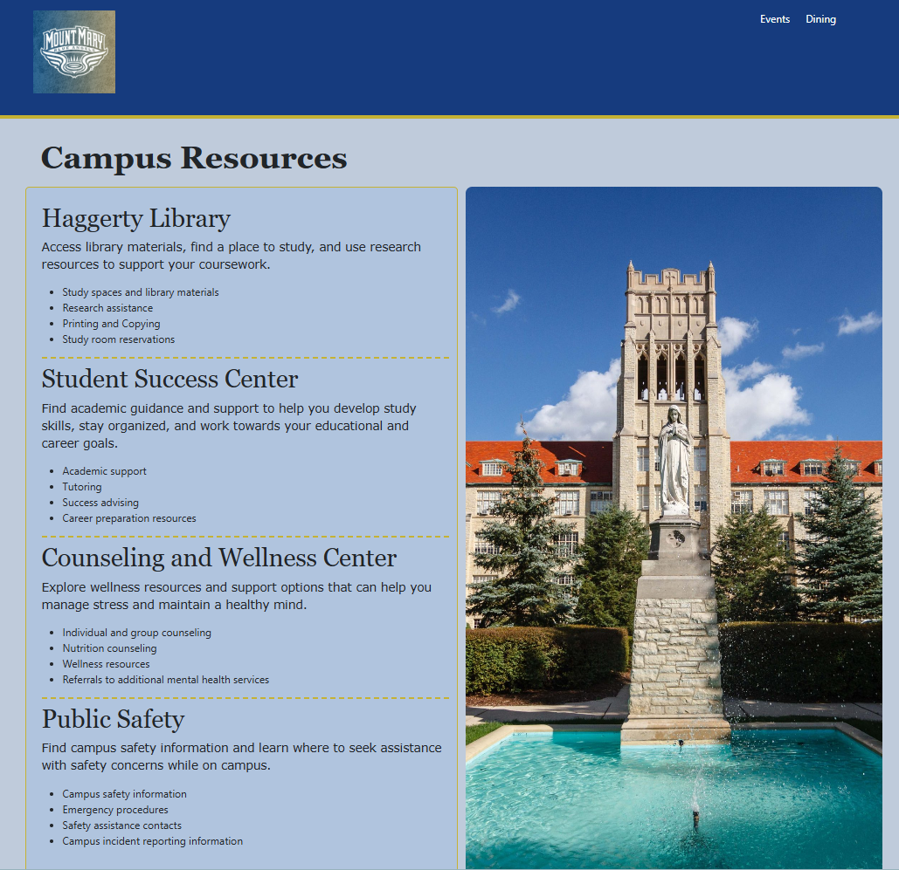
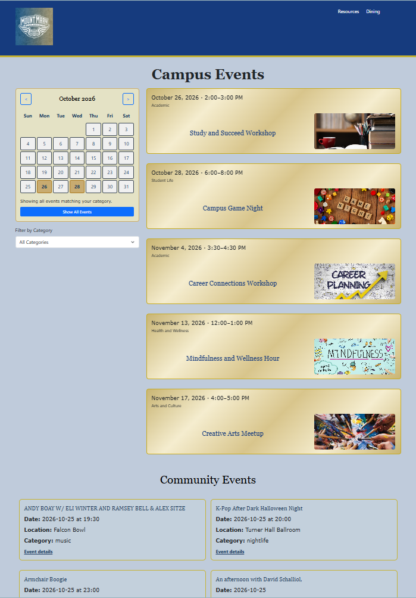
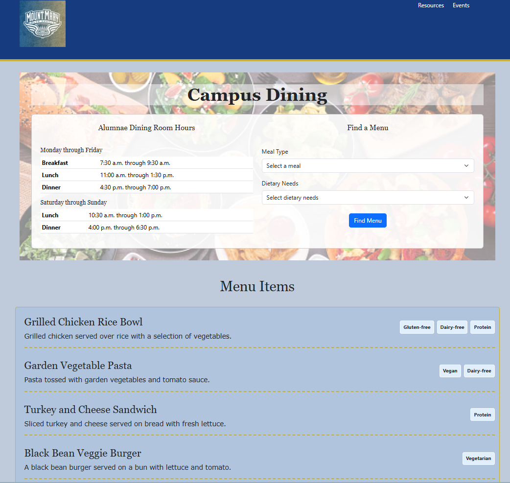

# Campus Life Super App

The Campus Life Super App is a website designed to bring campus resources, events, and dining information together in one place. It provides students with a central location to explore useful resources, view event information, and find dining options both on campus and in the community.
**Note:** Campus events and menu information are sample data and do not reflect actual campus events and menu offerings.

## Technologies Used
- HTML5
- CSS3
- Bootstrap 5.3.8
- JavaScript
- Find Local API
- OpenStreetMap Overpass API
- Visual Studio Code 
- Live Server
- GitHub
- GitHub Pages

## Setup Instructions
1. Download or clone the files from this GitHub repository.
2. Open the project in Visual Studio Code.
3. Use Live Server to view the web pages in your browser, or download Live Server if needed.
4. Use navigation in the header and footer to move between web pages.

## Project Features

### Resources Page
The Resources page provides campus and community resource information with a campus map for directions.

#### How to use it:
1. Open the Resources page from the main navigation.
2. Browse the campus resource information.
3. View the community resource cards and click their buttons for additional information.
4. Use the campus map to explore the locations displayed on the page and filter by category and location.

### Events Page
The Events page combines a campus calendar with sample campus events and community event information.

#### How to use it:
1. Navigate to the Events page.
2. Explore the calendar and select a date to interact with the calendar.
3. Use the category dropdown filter beneath the calendar to filter campus events by category.
4. Browse the event cards to view the sample campus event information.
5. Select an event card's interactive title to flip the card and view additional details.
6. Review community events retrieved from the Find Local API when the service is available.

**Data note:** The campus event cards contain sample data and are intended to demonstrate the website's design and functionality. They are not a verified schedule of actual campus events.

### Dining Page
The Dining page provides sample campus dining information, menu search filters, and local restaurant information with the OpenStreetMap Overpass API.

#### How to use it:
1. Navigate to the Dining page.
2. Browse the dining information and sample campus dining content.
3. Use the available menu search controls to select a meal type or dietary need.
4. Review restaurant listings retrieved through the OpenStreetMap Overpass API when the request succeeds.

**Data note:** Campus dining information is sample data. Menu details and availability do not reflect current dining services. Restaurant information retrieved from OpenStreetMap may also be incomplete or outdated.

## Troubleshooting

### Community Events Fail to Load
1. Check your internet connection.
2. Review the browser console and Network tab for the failed API request.
3. An HTTP 429 Too Many Requests response means the service is limiting requests. Wait before retrying, and check the provider's usage limits if the problem continues.
4. Confirm that any required API key is configured correctly.
5. Remember that the external service may be temporarily unavailable.

### Local Dining Information Fails to Load
1. Check the browser console and Network tab for errors from the Overpass API.
2. Retry later if the service is temporarily unavailable or busy.
3. Keep in mind that external services can limit requests, and the website cannot guarantee that restaurant data will always load.

## Future Improvements
1. Additional and live content for campus events, dining, and resources.
2. Search features for API interactivity.
3. Improved accessibility and responsiveness for different screen sizes.

